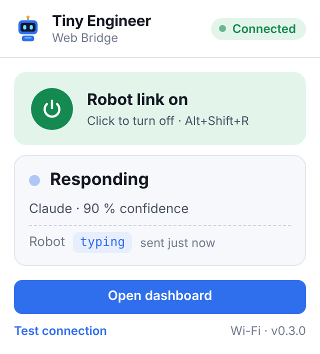
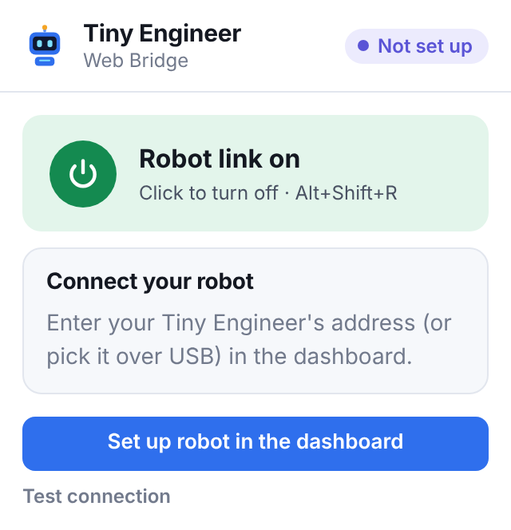
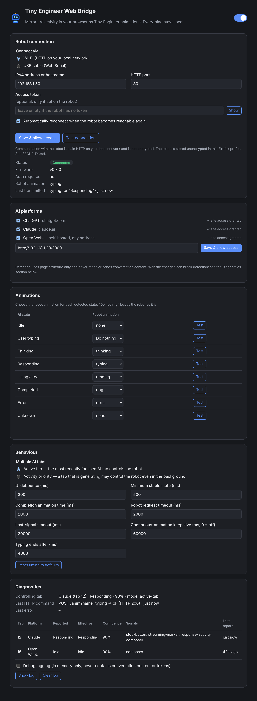

# Tiny Engineer Web Bridge

A privacy-focused browser extension for **Firefox** and **Chrome** that watches the activity of web AI assistants — **ChatGPT**, **Claude** and any self-hosted **Open WebUI** instance — and mirrors it as physical animations on the [Tiny Engineer](https://github.com/jamro/tiny-engineer) desktop robot.

The robot is driven **directly from the extension** over your local **Wi-Fi (HTTP)** or — in Chrome — a **USB cable (Web Serial)**. No API keys, no server, no cloud, no telemetry.

| | Firefox | Chrome / Chromium |
| --- | --- | --- |
| Wi-Fi | ✓ (tested by hand on Fedora) | ✓ (automated end-to-end test in Chromium) |
| USB | ✗ — Firefox grants Web Serial only to websites, not to extensions | ✓ via a pinned “USB connection” tab (not yet tested with hardware) |
| Install | signed `.xpi` (or temporary add-on) | “Load unpacked” in developer mode |

| Popup | First start | Settings |
| --- | --- | --- |
|  |  |  |

> Screenshots are rendered from the built pages with sample data, not captured from a live browser session.

## Features

- Detects the normalized states `idle`, `user_typing`, `thinking`, `responding`, `tool_use`, `completed`, `error`, `unknown` mainly from **page structure** (submit events, streaming markers, answer blocks, DOM activity in the answer area). The only on-screen text that is looked at: short status headers of non-text answer blocks (“Thinking…”, “Searching the web”, max. 80 characters) to tell thinking from tool use, and whether the prompt box is empty. Both are evaluated in memory and reduced to a category/boolean; no text is stored or sent.
- Configurable state → animation mapping (every native firmware animation, or “Do nothing”), with a **Test** button per state.
- Short completion animation (`ring`), then back to idle — without cutting the one-shot animation short.
- Central state machine: debouncing, minimum stable time, duplicate suppression, last-state-wins command queue (max. one command per second, matching the firmware's 1 s hold), exponential back-off while the robot is unreachable, keepalive for long responses (prevents the firmware's `continuous_timeout` → `attention` mid-answer).
- Never leaves the robot in a busy state when the signal is lost: busy tabs must send heartbeats, otherwise they fall back to `unknown` → `none`.
- Multiple AI tabs: **active-tab** mode (default) or **activity-priority** mode, with deterministic arbitration.
- Two transports: **Wi-Fi** (`GET /auth`, `GET /health`, `GET /anim`, `POST /anim?name=…`, optional Bearer token) and **USB / Web Serial** in Chrome (upstream COBS-framed serial protocol: `sync`, `health`, `anim`).
- Popup with connection status, firmware version, current robot animation, last transmitted state; options page with diagnostics (per-tab state, confidence, signals, last command, last error) and an opt-in in-memory debug log.
- Minimal permissions; content scripts are only registered for platforms you enable.

## Turning it on and off

- The toolbar icon shows the state: coloured = on, grey with **OFF** = off.
- Click the icon → big **Robot link on/off** button and **Open dashboard** in the popup, or press **Alt+Shift+R**.
- Prefer one click? Settings → Behaviour → *One click turns on/off* (or right-click the icon → *One click on the icon turns on/off*). Settings are then in the right-click menu.
- Change the shortcut: Firefox `about:addons` → gear → *Manage Extension Shortcuts*; Chrome `chrome://extensions/shortcuts`.
- Icon not visible? Pin it: puzzle icon in the toolbar → pin *Tiny Engineer Web Bridge*.

## Supported AI platforms

| Platform | Site | Selector status |
| --- | --- | --- |
| ChatGPT | `https://chatgpt.com` | Assumptions based on publicly observed markup — **not verified against the live site** |
| Claude | `https://claude.ai` | Assumptions based on publicly observed markup — **not verified against the live site** |
| Open WebUI | any origin you configure (e.g. `http://192.168.1.20:3000`) | Derived from Open WebUI source (commit `0666e59`, 2026-11-17) — not yet run against a live instance |

Details, selectors and limitations: [docs/DETECTION.md](docs/DETECTION.md).

## Requirements

- Firefox desktop **142 or newer**, or Chrome/Chromium **120 or newer**.
- A provisioned Tiny Engineer robot (Wi-Fi mode, or USB-only/any mode for serial).
- For development: Node.js ≥ 20.19 and npm.

## Install a release

1. Download `tiny-engineer-web-bridge-<version>-signed.xpi` from the [Releases](https://github.com/nmiller-engineering/tiny-engineer-web-bridge/releases) page (present when the release was signed by Mozilla).
2. In Firefox open `about:addons` → gear menu → **Install Add-on From File…** and pick the file.
3. The settings page opens automatically — follow the three steps shown there.

Unsigned `.xpi` files from Releases only install permanently in Firefox Developer Edition/Nightly; in normal Firefox use them as a temporary add-on (below). `SHA256SUMS.txt` lets you verify downloads; `…-source.zip` contains the exact sources.

## Install in Chrome / Chromium

1. Download `tiny-engineer-web-bridge-<version>-chrome.zip` from Releases (or build it: `npm run package:chrome`) and **extract** it into a folder you keep.
2. Open `chrome://extensions`, switch on **Developer mode** (top right).
3. Click **Load unpacked** and select the extracted folder (the one containing `manifest.json`). From source, select `dist-chrome/` after `npm run build:chrome`.
4. The settings page opens; continue with “Connecting the robot”.

Chrome keeps unpacked extensions across restarts (it may show a “developer mode extensions” reminder). The extension is not published in the Chrome Web Store.

## Installation on Fedora (from source)

### 1. Build

```bash
sudo dnf install nodejs npm git
```

```bash
git clone https://github.com/nmiller-engineering/tiny-engineer-web-bridge.git
```

```bash
cd tiny-engineer-web-bridge
```

```bash
npm install
```

```bash
npm run build
```

### 2. Load temporarily (development)

1. Open `about:debugging` in Firefox.
2. **This Firefox** → **Load Temporary Add-on…**
3. Choose `dist/manifest.json`.

Temporary add-ons are removed when Firefox restarts. Alternatively `npm run start:firefox` starts a fresh Firefox profile with the extension loaded (uses `web-ext run`).

### 3. Persistent install (signed, unlisted)

Release Firefox only installs **signed** extensions permanently. You do not have to publish it: Mozilla signs “unlisted” add-ons for self-distribution.

1. Create API credentials at <https://addons.mozilla.org/developers/addon/api/key/>.
2. If you fork the project, change `browser_specific_settings.gecko.id` in `src/manifest.json` to an ID you own.
3. Build and sign:

```bash
npm run build
```

```bash
npx web-ext sign --source-dir dist --channel unlisted --api-key "$AMO_JWT_ISSUER" --api-secret "$AMO_JWT_SECRET"
```

4. Install the resulting `.xpi` from `web-ext-artifacts/` via `about:addons` → gear menu → **Install Add-on From File…**

`npm run package` builds an unsigned, **reproducible** `.xpi` (sorted entries, fixed timestamps; set `SOURCE_DATE_EPOCH` to change the timestamp). Unsigned XPIs only install permanently in Firefox Developer Edition/Nightly with `xpinstall.signatures.required=false`.

## Connecting the robot

Open the extension's **Settings** (popup → Settings). The options page also opens automatically after the first install.

### Wi-Fi (default)

1. Enter the robot's IPv4 address (shown on its OLED) or hostname (`tiny-engineer.local`) and the port (80).
2. If you set an `access_token` on the robot, enter it as the token.
3. Press **Save & allow access** and accept the browser's permission prompt for that address. The extension cannot reach the robot without this per-host permission.
4. **Test connection** checks `GET /auth`, `GET /health` and `GET /anim` (no motion).

### USB / Web Serial (Chrome only)

**Firefox:** not available. Firefox grants Web Serial only to normal websites (after installing a site-permission add-on), not to extensions, so the USB option is disabled there. Use Wi-Fi.

**Chrome:**
1. Select **USB** in *Robot connection*.
2. Connect the robot by USB and close any other program that holds the port (e.g. `tiny-engineer daemon release` if you use the upstream CLI).
3. Press **Choose USB device** and pick the robot (Espressif devices are pre-filtered; tick “Show all serial devices” for other USB-serial chips).
4. A pinned **“USB connection”** tab opens. **Keep it open** — Chrome's extension service worker has no Web Serial API, so this tab owns the port and executes the robot commands. Only one such tab is active at a time.

Notes:
- The serial protocol has no token; physical access is authorization.
- The firmware has no read-only “current animation” query over serial, so the popup shows the animation from the last command reply.
- Opening the port can reboot the ESP32-C3; the client waits for the protocol (`sync`) before sending commands.
- On Linux your user must be allowed to open `/dev/ttyACM*` (on Fedora: member of `dialout`).

### Platforms

ChatGPT and Claude are enabled by default. For Open WebUI enter the exact origin of your instance (scheme, host, port), press **Save & allow access** and accept the permission prompt. No address is assumed.

## Development

```bash
npm run dev            # rebuild dist/ on change
npm run start:firefox  # run Firefox with the extension (second terminal)
npm run build:chrome   # Chrome build in dist-chrome/ (dev:chrome to watch)
npm run test:e2e       # end-to-end test of the Chrome build in real Chromium
npm run test           # unit, detector (jsdom), integration tests
npm run lint           # ESLint + TypeScript
npm run lint:firefox   # Mozilla addons-linter (web-ext lint) on the build
npm run package        # reproducible .xpi in web-ext-artifacts/
npm run package:chrome # reproducible Chrome .zip in web-ext-artifacts/
npm run package:source # reproducible source archive (for Mozilla review)
npm run release:check  # everything a release needs, in one go
npm run mock-robot -- --port 8080 [--token secret]   # fake robot for manual tests
```

With the mock robot running, configure host `127.0.0.1`, port `8080` in the extension to watch the commands it receives.

### Releasing

1. Update `version` in `package.json` and add a section to `CHANGELOG.md`.
2. Run `npm run release:check`.
3. Commit, then push a tag `vX.Y.Z` on `main`. The *Release* workflow verifies, packages, signs (if the repository secrets `AMO_JWT_ISSUER`/`AMO_JWT_SECRET` exist) and publishes a GitHub Release with checksums.

Architecture: [ARCHITECTURE.md](ARCHITECTURE.md) · Security model: [SECURITY.md](SECURITY.md) · Contributing: [CONTRIBUTING.md](CONTRIBUTING.md) · Manual test checklist: [docs/MANUAL_TESTING.md](docs/MANUAL_TESTING.md)

## Default mapping

| AI state | Robot animation | Why |
| --- | --- | --- |
| idle | `none` | rest pose |
| user_typing | *Do nothing* | upstream `attention` plays a voice clip and a 1-minute wait loop — too intrusive for every keystroke. Selectable if you want it. |
| thinking | `thinking` | |
| responding | `typing` | |
| tool_use | `reading` | |
| completed | `ring` | one-shot; the robot returns to `none` by itself |
| error | `error` | |
| unknown | `none` | safe fallback |

## Troubleshooting

| Symptom | What to check |
| --- | --- |
| Status “Access not granted” | Settings → **Save & allow access** and accept the prompt. |
| “Disconnected” / timeout | Same network? Robot IP changed? Try `curl http://<ip>/health`. mDNS (`.local`) only works on 2.4 GHz networks — use the IP. |
| “Robot rejected the access token (401)” | Token in settings must equal the robot's `access_token`. |
| “Robot answered with a redirect” | Robot is in setup/provisioning mode — finish its setup wizard. |
| “not provisioned (503)” | Same: complete the robot's setup. |
| USB disabled in Firefox | Expected: Firefox does not allow extensions to use Web Serial. Use Wi-Fi, or the Chrome version. |
| Chrome: “The USB connection tab is not open” | Settings → USB → **Open USB tab**, and keep that tab open (pin it). |
| USB: “Cannot open the USB port” | Another program holds it (upstream daemon, serial monitor, flasher). |
| Robot does not react to an AI site | Options → Diagnostics: is the tab listed? Which signals? An empty list for a busy page means the site's markup changed — please open an issue with the signals shown (no conversation content needed). |
| Robot keeps animating after closing the browser | The extension cannot send anything after the browser exits; the firmware's `continuous_timeout` (default 5 min) ends continuous animations. |

## Known limitations

- **Live website detection is unverified.** ChatGPT and Claude selectors are assumptions; Open WebUI selectors come from source code. All detectors are tested against synthetic fixtures only. Websites change; detection then degrades to `idle`/`unknown` rather than inventing activity.
- **Thinking vs. responding** is inferred from the UI: “thinking” means a request is in progress but no answer output is (yet) visible; it does not reflect the model's internal state.
- **Tool use** is only detected for Open WebUI (status shimmer). ChatGPT/Claude tool activity appears as thinking/responding.
- English UI labels are used as a fallback for some stop buttons; other UI languages rely on language-independent selectors only.
- **USB:** not available in Firefox (Firefox restricts Web Serial to websites). In Chrome it needs the USB connection tab to stay open; the messaging path is tested end-to-end in Chromium, but not yet with a real robot on USB.
- **Wi-Fi in Chrome** is tested end-to-end against the mock robot in Chromium; Chrome's local-network-access rules for extensions have not been tested against a robot on a real LAN.
- The Wi-Fi link is unencrypted HTTP (firmware limitation). See [SECURITY.md](SECURITY.md).
- Not tested on Firefox for Android.

## Privacy model

- Runs entirely locally; no telemetry, analytics, remote logging, or remotely loaded code.
- Content scripts send only enumerated values (platform, state, confidence, fixed signal names, sequence number). They have no access to configuration, tokens, storage or the network (enforced by lint rules and tests).
- The only outbound traffic is to **your robot**, on four fixed endpoints (or three serial ops).
- Settings live in the extension storage of your browser profile (unencrypted, never synced).
- Full policy: [PRIVACY.md](PRIVACY.md).

## Attribution

Tiny Engineer is created by [jamro](https://github.com/jamro/tiny-engineer); its HTTP API and serial protocol are documented in that repository (`docs/api.md`, `docs/serial.md`, `docs/integration.md`). This project is an independent client and does not modify the firmware. ChatGPT, Claude and Open WebUI are trademarks of their respective owners; this project is not affiliated with them.

## License

[MIT](LICENSE)
